# Architecture diagrams

Pictures of how ColorMesh fits together, in levels. Start with **The whole system**; under each diagram, **Zoom
in** lists the boxes that open into a diagram of their own. The prose version of the firmware is
`docs/ARCHITECTURE.md`, the research that chose the radio design `docs/RESEARCH-BLE.md`, what the PC tools read
from the firmware `docs/PROTOCOL.md`, and how a tag becomes a release `docs/RELEASING.md`.

**Interactive version:** `docs/diagrams.html` shows the same diagrams with pan, zoom and click-to-zoom-in. It
reads this file, so the two never disagree. Open it through any web server, for example
`python -m http.server -d docs 8000`, then <http://localhost:8000/diagrams.html> (or the preview config
`diagrams` in `.claude/launch.json`).

Map of the levels:
- [The whole system](#the-whole-system)
  - [One board](#one-board)
    - [The firmware, module by module](#the-firmware-module-by-module)
      - [The screens](#the-screens)
        - [From a finger to every screen](#from-a-finger-to-every-screen)
    - [Tasks and what they own](#tasks-and-what-they-own)
  - [The Bluetooth mesh](#the-bluetooth-mesh)
    - [The flood: one advertisement, every 20 ms](#the-flood-one-advertisement-every-20-ms)
      - [The 30 bytes on air](#the-30-bytes-on-air)
      - [The peer table and the mix](#the-peer-table-and-the-mix)
    - [Waves, calls and the game: effects in the flood](#waves-calls-and-the-game-effects-in-the-flood)
    - [Voice clips: the periodic train](#voice-clips-the-periodic-train)
  - [Updates](#updates)
    - [The dev-mode pull over Bluetooth](#the-dev-mode-pull-over-bluetooth)
      - [Who pulls from whom](#who-pulls-from-whom)
      - [The firmware link, packet by packet](#the-firmware-link-packet-by-packet)
      - [Boot, confirm or roll back](#boot-confirm-or-roll-back)
    - [Secure updates: the paired admin board](#secure-updates-the-paired-admin-board)
    - [Versions and their order](#versions-and-their-order)
  - [The PC side: USB, console and flash helper](#the-pc-side-usb-console-and-flash-helper)
  - [From a tag to the boards](#from-a-tag-to-the-boards)

Rules for editing (checked by `python tools/check_diagrams.py`, run by CI's host-tests job): one Mermaid diagram
per section; each **Zoom in** line names a box by its id in that diagram and links to a section heading; every
section can be reached from the top and is on the map above.

## The whole system

Three small round screens share colours over Bluetooth LE. No Wi-Fi, no phone, no app: every board shouts its
own state on the air every 20 ms and listens to the others all the time. A person installs and configures a board
over USB from a web page; after that, a board in dev mode takes a newer firmware from a nearby board by itself.

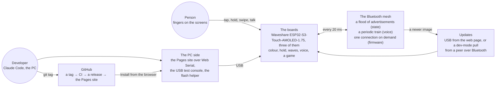

**Zoom in:**
- The boards (`boards`) → [One board](#one-board)
- The Bluetooth mesh (`mesh`) → [The Bluetooth mesh](#the-bluetooth-mesh)
- Updates (`updates`) → [Updates](#updates)
- The PC side (`pc`) → [The PC side: USB, console and flash helper](#the-pc-side-usb-console-and-flash-helper)
- GitHub (`release`) → [From a tag to the boards](#from-a-tag-to-the-boards)

## One board

One Waveshare ESP32-S3-Touch-AMOLED-1.75: an ESP32-S3 with 16 MB of flash and 8 MB of PSRAM, a 466×466 round
AMOLED, a touch controller, two microphones and a speaker, and USB serial/JTAG. The firmware is an ESP-IDF app
built on espforge (board support, LVGL pager, test console, diagnostics). The one 2.4 GHz radio runs Bluetooth LE
only: Wi-Fi is never started.

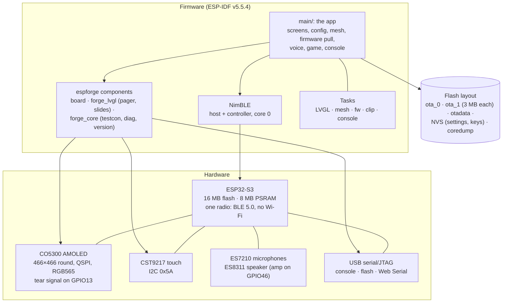

**Zoom in:**
- The app (`app`) → [The firmware, module by module](#the-firmware-module-by-module)
- Tasks (`tasks`) → [Tasks and what they own](#tasks-and-what-they-own)
- Flash layout (`flash`) → [Boot, confirm or roll back](#boot-confirm-or-roll-back)

## The firmware, module by module

Every file in `main/`, in groups. The pure C files (no ESP-IDF, time always an argument) are the ones the host
tests build with gcc and AddressSanitizer in `tests/host/`: the wire format, the peer table and the mix, the
waves, the game rules, the signed-pull messages, the clip chunks, the call state. An arrow means "calls".

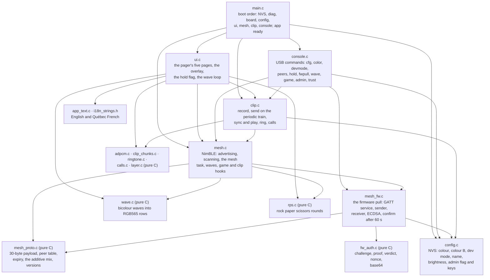

**Zoom in:**
- ui.c (`ui`) → [The screens](#the-screens)
- mesh.c (`mesh`) → [The flood: one advertisement, every 20 ms](#the-flood-one-advertisement-every-20-ms)
- mesh_proto.c (`proto`) → [The 30 bytes on air](#the-30-bytes-on-air)
- mesh_fw.c (`fw`) → [The dev-mode pull over Bluetooth](#the-dev-mode-pull-over-bluetooth)
- fw_auth.c (`auth`) → [Secure updates: the paired admin board](#secure-updates-the-paired-admin-board)
- clip.c (`clip`) → [Voice clips: the periodic train](#voice-clips-the-periodic-train)

## The screens

One LVGL pager with five pages, swiped left and right. Boot shows **main** when a colour is saved, else **pick**.
Every page but system shows the mesh behind it: the mix as a disc, and the waves, drawn by a 33 ms raw-frame loop
straight to the panel. An overlay on the top layer takes the screen for an incoming clip or call.

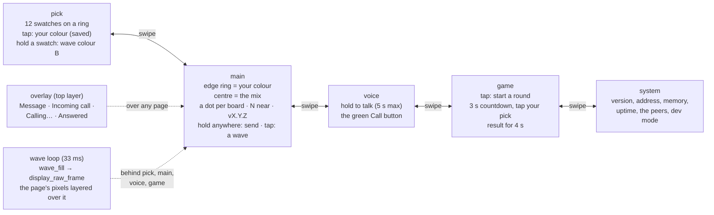

**Zoom in:**
- main (`main`) → [From a finger to every screen](#from-a-finger-to-every-screen)
- wave loop (`loop`) → [Waves, calls and the game: effects in the flood](#waves-calls-and-the-game-effects-in-the-flood)
- overlay (`overlay`) → [Voice clips: the periodic train](#voice-clips-the-periodic-train)

## From a finger to every screen

What happens when you hold the main screen, and why it reaches the other boards within about one 20 ms
advertising event. The touch handler only sets a flag. The mesh task re-encodes the advertisement in place. Every
other board's scan callback copies the 30 bytes into a queue, and its mesh task updates the table and the mix.
Release is explicit: every advertisement after the finger lifts says "not holding", so nothing sticks.

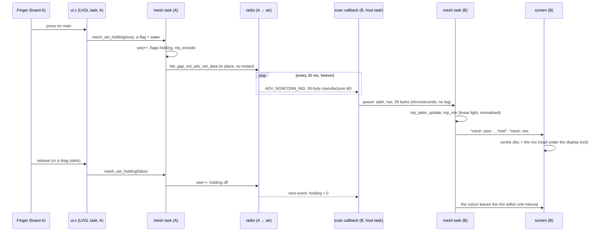

Measured on three boards: a peer's hold reaches the mix 0-1 ms after its report; a missed event costs 20 ms;
about 61 % of events are heard at the 100/100 ms scan.

## Tasks and what they own

Who may call what. The rule from espforge's lesson L164: the UI only sets flags; the mesh task does the radio;
nothing is sent from a touch callback. The NimBLE host task only copies and posts. Every NimBLE procedure, flash
write and log line of the firmware pull is in the fw task.

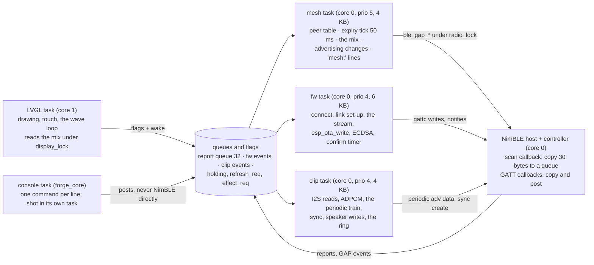

## The Bluetooth mesh

Three ways the radio is used, all from one NimBLE stack. The flood carries every board's state and is enough for
colours, holds, waves, calls and the game. Voice needs more bytes per second than a 31-byte advertisement gives,
so a clip rides a BLE 5 periodic advertising train that every listener syncs to: one send, every board. A firmware
image needs a reliable stream, so that one case opens a GATT connection between two boards. The research report
rejected SIG mesh (8-byte vendor payload, ~90 ms per message, a provisioner), GATT meshes (an election at ten
boards) and ESP-NOW (Wi-Fi).

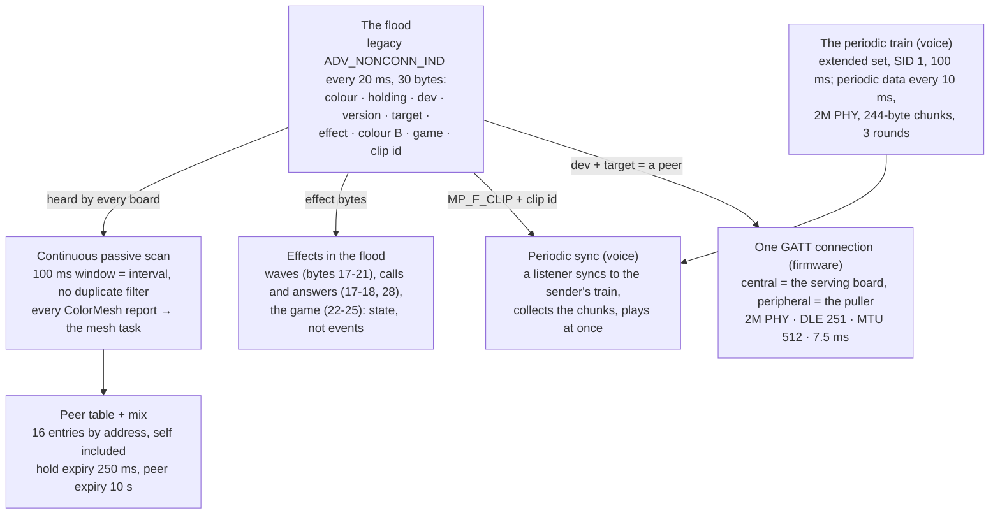

**Zoom in:**
- The flood (`flood`) → [The flood: one advertisement, every 20 ms](#the-flood-one-advertisement-every-20-ms)
- Peer table + mix (`table`) → [The peer table and the mix](#the-peer-table-and-the-mix)
- Effects in the flood (`effects`) → [Waves, calls and the game: effects in the flood](#waves-calls-and-the-game-effects-in-the-flood)
- The periodic train (`train`) → [Voice clips: the periodic train](#voice-clips-the-periodic-train)
- One GATT connection (`link`) → [The dev-mode pull over Bluetooth](#the-dev-mode-pull-over-bluetooth)

## The flood: one advertisement, every 20 ms

How `mesh.c` keeps the state on the air. Since v0.6.0 the stack runs with extended advertising on: the flood is
extended advertising instance 0 with legacy PDUs, so on air nothing changed and older boards still hear it. The
advertisement is non-connectable in normal use (nobody can connect to a board); it turns connectable only while
the board wants firmware. A state change bumps `seq` and rewrites the data in place, no stop/start. The research
report's 20 ms is the NimBLE floor; the controller accepted it (risk 1), with a 100 ms fallback coded in.

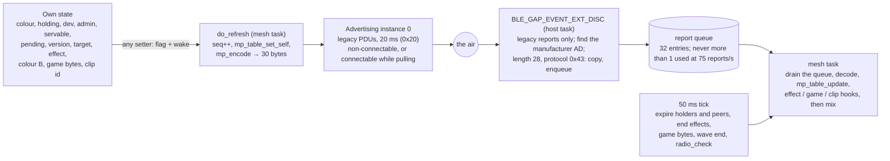

Rate limits measured on board A: 71-75 reports/s from ~13 neighbours, the GAP callback at most 67 µs, 0 drops. The
first build heard neighbours in bursts because `CONFIG_BT_NIMBLE_HOST_QUEUE_CONG_CHECK` passed each address once
per ~200 reports; it is off (risk 2).

**Zoom in:**
- Own state (`state`) → [The 30 bytes on air](#the-30-bytes-on-air)
- mesh task (`task`) → [The peer table and the mix](#the-peer-table-and-the-mix)

## The 30 bytes on air

One manufacturer-data AD structure fills the whole 31-byte legacy payload (no Flags AD: with non-discoverable
mode every flag is zero, so the spec allows leaving it out). The company id is `0xFFFF`; byte 4, the protocol id
`0x43`, is what really guards it. The origin id is the low byte of the board's public address. Every field is
state, never an event: a lost packet costs one interval, never a stuck colour.

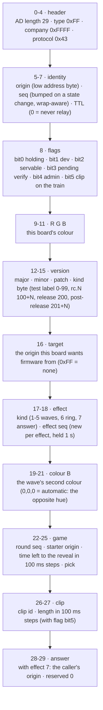

The game bytes and the clip bytes are stored but not part of "changed" in `mp_table_update`: the time left moves
every 100 ms and must not log a peer line each time.

## The peer table and the mix

`mesh_proto.c`, pure C and host-tested. The table has 16 entries keyed by address; a full table replaces the
least recently heard peer. A strictly older `seq` is ignored unless three come in a row (the peer rebooted). Self
is one more entry, so the holder sees its own colour in its mix too (a board never hears its own advertisements).
The mix adds the holders' colours in linear light and scales so the largest channel is full: red and blue make
magenta, all three make white, and nothing looks dim or drifts to white.

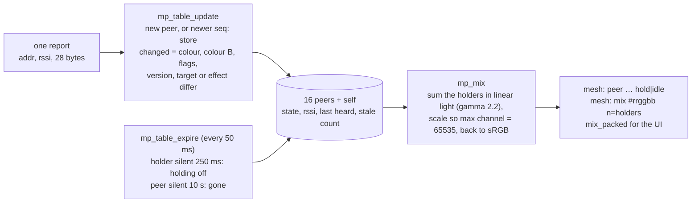

## Waves, calls and the game: effects in the flood

Three features ride on the same bytes. A **wave** (a tap on main) starts here at once and puts effect = kind with
a new effect seq in the advert for 1 s; a peer whose (effect, seq) is new starts that wave at its own clock, in
the sender's colours. A **call** is effect 6 the same way; a tap on the ringing board sends effect 7 with the
caller's origin in byte 28, and only the caller reacts. A **game round** is bytes 22-25: a tap starts a round with
the reveal 3 s away; a board that hears a round it does not know, with time left, joins it with the same reveal;
two rounds at once, the lower starter origin wins everywhere. 600 ms after the reveal the picks heard decide.

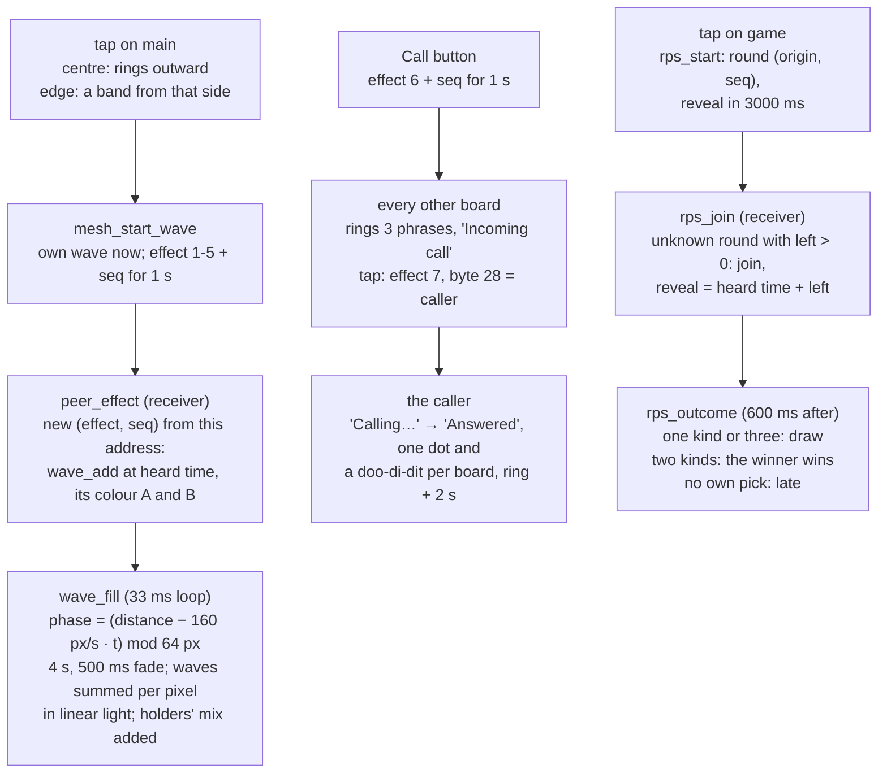

Measured: one wave 29 fps, five waves 21 fps on the raw-frame loop; a round started on B was joined by A with
3000 ms left and both showed the result 3.6 s later.

## Voice clips: the periodic train

True multicast: one send reaches every board at once, not one link per board. Hold the voice page and talk (up to
5 s at 16 kHz, both microphones averaged, DC removed, a quiet clip scaled up). IMA ADPCM makes 5 s into 40,000
bytes. The sender starts extended advertising instance 1 (SID 1, 100 ms, 2M secondary PHY) with a periodic train
every 10 ms, and swaps the periodic data every 10 ms: one 224-byte chunk per packet, 3 rounds over all chunks, so
5 s of voice takes 5.4 s on air for any number of listeners. Meanwhile the flood advert carries flag bit5 and the
clip id. A board that hears a new clip id from that address syncs to the train, fills a bitmap of chunks, and plays
as soon as every chunk is in and the CRC-32 matches. A lost train, no sync within 4 s or a bad CRC drops it. One
hop only.

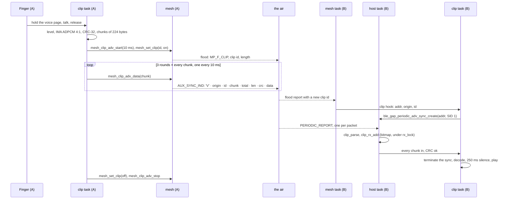

Verified on three boards: B's 5 s clip reached A whole (179 chunks, 0 holes) and C. The flood stayed at 58-60
ColorMesh reports/s with extended advertising on (62 before).

## Updates

Three ways a new firmware gets onto a board, and one way back. No board ever polls the web site: the site serves
people, not devices. Every image carries its version and an appended SHA-256; the bootloader keeps two app slots
and rolls back a new image that does not confirm itself within 60 s of normal running.

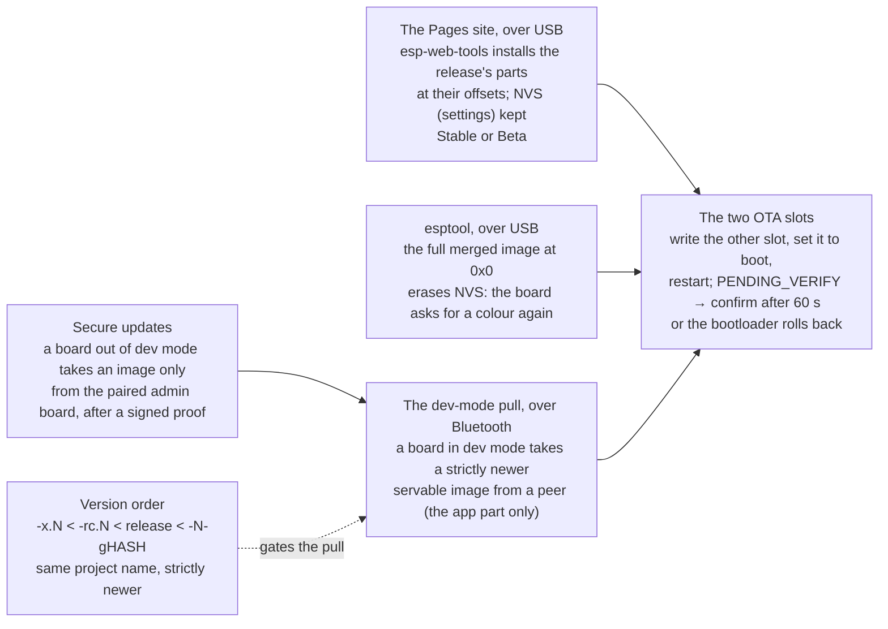

**Zoom in:**
- The dev-mode pull (`pull`) → [The dev-mode pull over Bluetooth](#the-dev-mode-pull-over-bluetooth)
- Secure updates (`signed`) → [Secure updates: the paired admin board](#secure-updates-the-paired-admin-board)
- The two OTA slots (`slots`) → [Boot, confirm or roll back](#boot-confirm-or-roll-back)
- Version order (`versions`) → [Versions and their order](#versions-and-their-order)
- The Pages site (`site`) → [From a tag to the boards](#from-a-tag-to-the-boards)

## The dev-mode pull over Bluetooth

`mesh_fw.c`. The puller decides, the server obeys. Every advertisement carries the version and a servable bit
(only while the running image is valid). A dev-mode board that sees a strictly newer servable version picks that
peer (highest version, then lowest address), advertises **connectable** with `target` = that peer's origin, and
waits up to 60 s. Only the named peer reacts: it connects as central, sets the link up one procedure at a time,
discovers the three characteristics, and streams its own running image from a flash mmap. Then the receiver
verifies, sets the boot slot and restarts. One pull at a time; a failed pull waits 30 s.

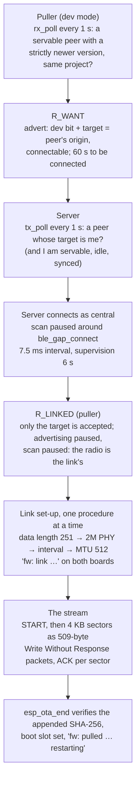

Measured: 1.1 MB in about 21 s at 52 KB/s, 0 resent, since rc.5. The link was never the limit (2M PHY, DLE 251,
MTU 512 all granted at 22 KB/s): the controller gave the connection one packet per event while the flood's
continuous scan was open. The fix is in the server: it scans 30 ms of every 100 ms while serving, and the puller
pauses its scan. `fwtune` changes these knobs in RAM and can stop a transfer after N KB to compare settings.

**Zoom in:**
- Puller (`seeA`) → [Who pulls from whom](#who-pulls-from-whom)
- The stream (`stream`) → [The firmware link, packet by packet](#the-firmware-link-packet-by-packet)
- esp_ota_end (`done`) → [Boot, confirm or roll back](#boot-confirm-or-roll-back)

## Who pulls from whom

The receiver's rule, run every second in the fw task. The same rule, with the admin bit, serves boards out of dev
mode. A version that rolled back on this board is never pulled again. `fwpull <addr>` on the console forces a
target and skips the version checks (dev mode only).

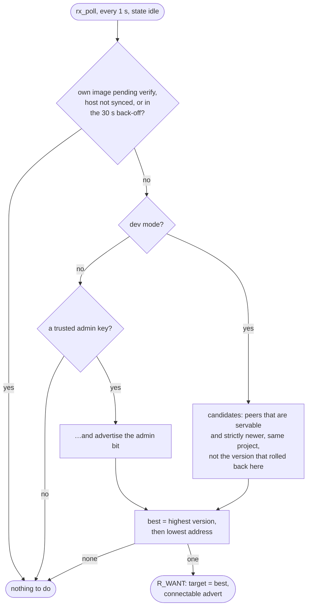

A pull also needs the server to agree: it serves only a peer whose advertised `target` is its own origin, and a
peer out of dev mode only if it is the admin.

## The firmware link, packet by packet

The GATT service every board carries (custom 128-bit UUIDs `6c6d000N-8e6b-4c1b-9a35-2d5e7f0c4b31`), used only
while pulling. The server writes; the receiver answers with notifications on ACK, which the server reads without
any subscription. Framing is Espressif's ble_ota style without the component: a sector is packets seq 0, 1, …
then one seq 0xFF packet with the rest and the sector's CRC16. The server keeps 4 sectors in flight beyond the
last ACK; the receiver buffers 8 sectors in a PSRAM ring and a write task feeds them to `esp_ota_write`. A bad
CRC asks for that sector again (go-back-N). An mbuf shortage backs off one tick, never a loss.

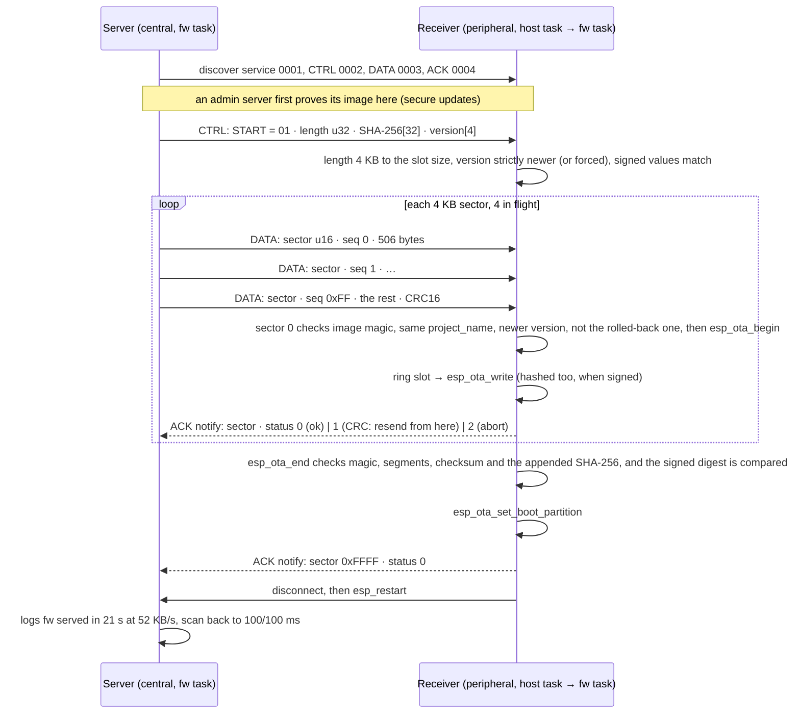

Every packet and ACK refreshes a 15 s idle timer on both sides; silence ends the pull. `fwloop` on the console
feeds this board's sender output straight into its own receiver (with one injected CRC error) into the other slot,
without Bluetooth, to test the framing and the OTA writes.

## Boot, confirm or roll back

The flash has two 3 MB app slots and an otadata record that says which one boots. A pull writes the other slot
and marks it to boot; the new image starts as PENDING_VERIFY. 60 s after start the fw task checks that the display
answers and the host is synced, then marks the image valid and turns the servable bit on. If the new image
crashes, or never confirms, the bootloader goes back to the previous slot, and that version is remembered as bad
and never pulled again. Never restart a board in its first 60 s after an update. A USB install writes
`ota_data_initial.bin`, so the board boots `ota_0` again.

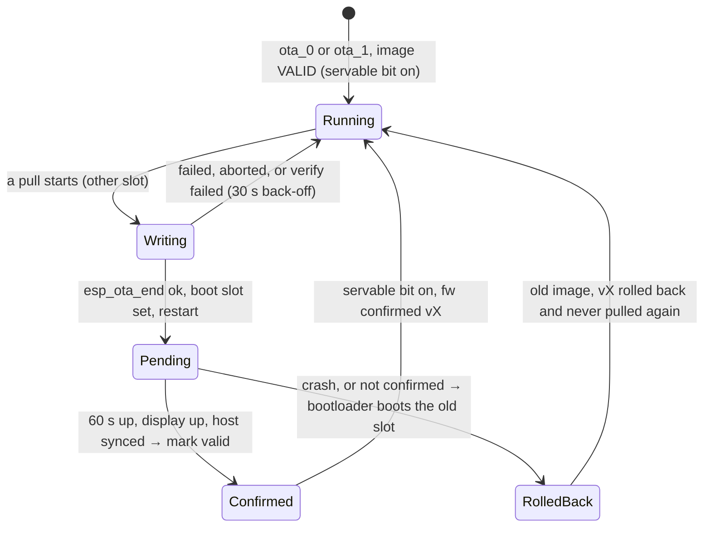

While its own image is pending, a board neither serves nor pulls.

## Secure updates: the paired admin board

For boards that should not take firmware from anyone (dev mode off). The user chose a paired admin over signed
releases. One board is made the admin (`admin on`): it keeps an ECDSA P-256 key pair in NVS and sets the admin bit
in its advertisement. Each other board stores the admin's public key once over USB (`trust <base64>`). After the
link is up and before START, the admin asks for a challenge; the receiver notifies a fresh 32-byte nonce (single
use, 10 s); the admin answers with a proof: nonce, image length, image digest, version, and a deterministic ECDSA
signature over the SHA-256 of those 100 bytes. The receiver checks the nonce, that the version is strictly newer,
and the signature with the trusted key, then accepts only a START with the signed length and digest, requires the
image's own version to equal the signed one, hashes every byte it writes and compares with the signed digest
before `esp_ota_end`. In dev mode the proof is checked when offered, never required.

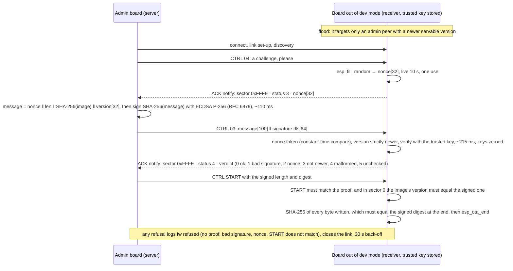

Why the admin asks instead of the receiver pushing a nonce: the server only knows the ACK handle after discovery,
and a v0.3.0 server treated any unknown ACK status as an abort. Measured on three boards: both paired boards
targeted the admin within 4 s of its boot, proof accepted, 22 s pulls at 52 KB/s. Host tests:
`tests/host/test_fw_auth.c` (81 checks); `fwloop baddigest` and `fwloop badsig` on the console exercise the two
late failures on one board.

## Versions and their order

One order, used in three places: forge_core's `version.c` (the firmware comparing full strings), CI (which
release the site offers), and the advertisement's version-kind byte (a 4-byte pre-filter before any connection).
A board pulls only a version **strictly above** its own with the same project name. Test builds are labelled with
`version.txt` above the current release and below every rc of the same X.Y.Z.

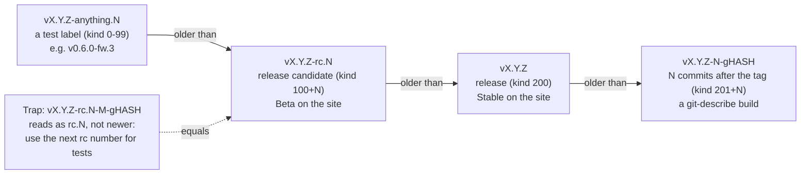

## The PC side: USB, console and flash helper

No network, so the USB serial/JTAG port is the only way into a board from a computer. Three things speak on it,
one at a time: the Pages site's *Configure over USB* card (Web Serial in Chrome or Edge), the test console used by
the harness and the devloop scripts, and esptool through the flash helper. The agent's shell may have no USB
access, so the flash helper runs on the PC, owns the COM port, and talks through plain files in `.devloop/`.

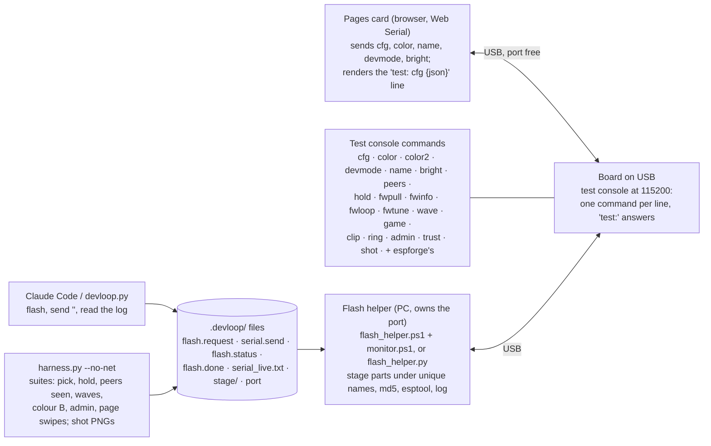

What each line means is the contract in `docs/PROTOCOL.md`: the harness and the card parse `diag:`, `cfg:`,
`ble:`, `mesh:`, `fw:` and `test:` lines, so a line the firmware stops printing breaks a tool silently.

## From a tag to the boards

A tag is a release. CI builds it on the same ESP-IDF as the PC, runs the board-free tests, publishes the parts on
GitHub, and rebuilds the Pages site from the published releases only. `vX.Y.Z-rc.N` moves the Beta channel;
`vX.Y.Z` moves Stable. Claude tags release candidates; a stable tag needs the user's OK. Then one board is
installed from the site over USB, and the others pull it over Bluetooth in dev mode.

```mermaid
flowchart LR
  tag["git tag vX.Y.Z-rc.N / vX.Y.Z<br/>CHANGELOG section written first"]
  ci["CI: Firmware workflow<br/>config (forge.json) · build (git describe → version.txt,<br/>esp-idf-ci-action, dist parts, merged full.bin) ·<br/>host-tests (gcc + ASan, harness unit tests,<br/>config card, check_diagrams)"]
  rel["GitHub release<br/>bootloader · partition table · ota_data_initial ·<br/>colormesh-<ver>.bin · full.bin · flash-parts.json<br/>pre-release if the tag has a '-'"]
  pages["Pages site<br/>channels.json (stable, beta) · manifest.json per channel ·<br/>notes.json from the CHANGELOG · config.js"]
  install["One board installed from the page<br/>Stable or Beta, over USB, NVS kept"]
  peers["The other boards<br/>in dev mode: they hear the newer version<br/>and pull it, 21 s each"]
  check["harness.py --no-net --expect vX.Y.Z-rc.N<br/>diag: firmware <ver>, diag: running from ota_N"]

  tag --> ci --> rel --> pages --> install --> peers --> check
```

**Zoom in:**
- The other boards (`peers`) → [The dev-mode pull over Bluetooth](#the-dev-mode-pull-over-bluetooth)
